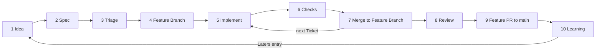

# SDLC

How an idea becomes a merged change on `main`, and how the Factory learns from it. This page is the frame: which Stages exist, who does them, when each is done and where its rules live. The rules themselves are in [`docs/workflow/`](../workflow/). Terms are in the [Factory glossary](GLOSSARY.md).

Each Stage has one Actor: the human, an agent (a Claude session running a skill) or a machine (a check that gives the same answer every run). A machine runs checks and never makes a decision; today a machine runs only when an agent or the human invokes it.

## Stages

The Gate is what must be true before work leaves the Stage. There is no CI or branch protection yet, so no Gate is checked by a machine on its own; plans are in [Laters](../laters.md). A hook stops an agent opening a PR while `pnpm docs:check` fails. When an Implementer stops, a hook runs the fast checks (the Diff-scope check, lint and typecheck of its packages, the test files it changed) and blocks the stop once on a failure; the definition of done still asks for the full `pnpm lint`, `pnpm typecheck` and `pnpm test` before the PR.

| #   | Stage                   | Actor                                                                       | Output                                                                                                                                         | Gate                                                                                                                      | Checked by | Rules                                                                                                    |
| --- | ----------------------- | --------------------------------------------------------------------------- | ---------------------------------------------------------------------------------------------------------------------------------------------- | ------------------------------------------------------------------------------------------------------------------------- | ---------- | -------------------------------------------------------------------------------------------------------- |
| 1   | Idea                    | Human, or an agent                                                          | A [Laters](../laters.md) entry, written without widening any Ticket                                                                            | None                                                                                                                      | Nobody     | [No assumptions](../workflow/no-assumptions.md)                                                          |
| 2   | Spec                    | Spec Writer, from the human's answers                                       | Grilling, the Spec and the Tickets, in a Spec PR into the Feature Branch                                                                       | The human merged it, every template field is filled                                                                       | Human      | [Git workflow](../workflow/git-workflow.md), [Ticket template](../workflow/ticket-template.md)           |
| 3   | Triage                  | Human; an agent may propose Statuses with `triage`                          | Each Ticket's Status                                                                                                                           | The Ticket is `ready-for-agent` or `ready-for-human`                                                                      | Human      | [Ticket status](../workflow/ticket-status.md)                                                            |
| 4   | Feature Branch          | Spec Writer pushes it; Orchestrator keeps it up to date with `main`         | The Feature Branch, pushed before grilling                                                                                                     | For each Ticket started: every Ticket in its `Blocked by` is `resolved`, and the Feature Branch is up to date with `main` | Machine    | [Git workflow](../workflow/git-workflow.md)                                                              |
| 5   | Implement               | Implementer, or the human for `ready-for-human` Tickets                     | One Ticket on one Task Branch, built with `tdd`. A Ticket whose content is the human's decisions starts with a grilling session                | The task PR is open                                                                                                       | Agent      | [Orchestrator](../workflow/orchestrator.md) for the hand-off                                             |
| 6   | Checks                  | Machine, invoked by the agent                                               | Check results                                                                                                                                  | The [definition of done](../workflow/definition-of-done.md) is ticked, machine checks included                            | Agent      | [Definition of done](../workflow/definition-of-done.md), [testing policy](../workflow/testing-policy.md) |
| 7   | Merge to Feature Branch | Orchestrator                                                                | The task PR squash-merged into the Feature Branch                                                                                              | The merge conditions hold                                                                                                 | Agent      | [Git workflow](../workflow/git-workflow.md#rules)                                                        |
| 8   | Review                  | Reviewer, then an Implementer, then Doc Sync if the Orchestrator decides so | `code-review` on the whole Feature Branch once every Ticket is merged, findings fixed, hand-written docs compared with the code                | The findings are fixed and `pnpm docs:check` passes                                                                       | Agent      | [Orchestrator](../workflow/orchestrator.md#doc-sync)                                                     |
| 9   | Feature PR to `main`    | Agent opens it, human reviews and merges                                    | A merge commit on `main`                                                                                                                       | Every Ticket and the Spec are `resolved`                                                                                  | Human      | [Git workflow](../workflow/git-workflow.md#finishing-the-feature)                                        |
| 10  | Learning                | Agent or human                                                              | Notes in [Laters](../laters.md). A review comment that repeats becomes a convention. A rule broken twice gets automated. A `retro` is optional | None                                                                                                                      | Nobody     |                                                                                                          |

## Agent Roles

What each agent session is for. Every Role follows the [no assumptions](../workflow/no-assumptions.md) rule, asks before editing skill-generated files (root `AGENTS.md`), and stops through [escalation](../workflow/escalation.md) when stuck.

The Spec Writer and the Orchestrator run as the main session, because they ask the human: a sub-agent has no `AskUserQuestion` and doesn't see the conversation. The other four are sub-agents, each spawned by its `subagent_type` from an agent file in `.claude/agents/`, and each reads its Role file first.

| Role                                  | Inputs                                                             | Outputs                                                                                                                                                                | Writes                                                                                                                                                                                                                                                                                                                   | Tools and skills                                                                                                                                     | Stops when                                                                | Model                                                                                                            |
| ------------------------------------- | ------------------------------------------------------------------ | ---------------------------------------------------------------------------------------------------------------------------------------------------------------------- | ------------------------------------------------------------------------------------------------------------------------------------------------------------------------------------------------------------------------------------------------------------------------------------------------------------------------ | ---------------------------------------------------------------------------------------------------------------------------------------------------- | ------------------------------------------------------------------------- | ---------------------------------------------------------------------------------------------------------------- |
| [Spec Writer](roles/spec-writer.md)   | An idea or a [Laters](../laters.md) entry, and the human's answers | `.scratch/NNNNN-<slug>/spec.md` and its `issues/NN-<slug>.md` Tickets from the [ticket template](../workflow/ticket-template.md), in a Spec PR into the Feature Branch | its Spec's folder, both glossaries, ADRs, Laters                                                                                                                                                                                                                                                                         | `grill-with-docs` or `grilling`, `domain-modeling`, `to-spec`, `to-tickets`                                                                          | The Spec PR is open, after the self-check in step 6.                      | The session's                                                                                                    |
| [Orchestrator](roles/orchestrator.md) | A Spec and its Tickets                                             | A Feature Branch, dispatched Roles, task PRs squash-merged into the Feature Branch, the feature PR to `main`                                                           | briefs, scope files, handoff notes (outside the repo), squash-merges of task PRs, the feature PR                                                                                                                                                                                                                         | `/orchestrator`, which runs `implement-spec` as in [orchestrator](../workflow/orchestrator.md). Writes no product code.                              | The feature PR is open, or every frontier Ticket is waiting on the human. | The session's                                                                                                    |
| [Explorer](roles/explorer.md)         | A question from a Ticket or the Orchestrator                       | Notes outside the repo                                                                                                                                                 | notes outside the repo                                                                                                                                                                                                                                                                                                   | `research`, `prototype`, read-only search. No `Edit`.                                                                                                | The note is written.                                                      | Sonnet                                                                                                           |
| [Implementer](roles/implementer.md)   | One Ticket                                                         | A Task Branch and a task PR to the Feature Branch, with the [definition of done](../workflow/definition-of-done.md) ticked                                             | the packages in its scope file, its own Ticket, the `Status:` line of `spec.md` when its brief says so, Descriptive Docs covering the code it changes, files its Ticket lists under Also writes, appends to Laters, Generated Docs through their generator, `package.json` and the lockfile only as Allowed packages say | `tdd`. Works in the main checkout, or in a separate [worktree](../workflow/worktree.md) when the Orchestrator runs two or more Implementers at once. | The task PR is open, or on Escalation.                                    | Sonnet; Opus when the Orchestrator passes it on an [Opus signal](../workflow/orchestrator.md#choosing-the-model) |
| [Reviewer](roles/reviewer.md)         | A PR or a branch                                                   | Findings reported to the Orchestrator or the human                                                                                                                     | nothing                                                                                                                                                                                                                                                                                                                  | `code-review`. No `Edit`, no `Write`; fixes go to an Implementer.                                                                                    | The findings are reported.                                                | Opus                                                                                                             |
| [Doc Sync](roles/doc-sync.md)         | The diff range, the Spec path, the hand-written docs to compare    | A task PR fixing Descriptive Docs, and a report of any Intent Doc that contradicts the code                                                                            | Descriptive Docs (`kind: descriptive`, checked by front matter)                                                                                                                                                                                                                                                          | Reads code and Specs, changes neither                                                                                                                | The task PR is open, or there is nothing to fix.                          | Sonnet                                                                                                           |

Each Role's Role file also states what it never writes.

## Where the human must approve

- Merging the Spec PR into the Feature Branch.
- Triage: setting a Ticket's Status from `needs-triage`.
- Answering a `needs-info` Ticket and setting it back to ready ([escalation](../workflow/escalation.md)).
- Reviewing and merging the feature PR to `main`.

## Merge and review

- The Implementer stops when the task PR is open. It does not merge.
- The Orchestrator squash-merges each task PR when the [git workflow](../workflow/git-workflow.md#rules) allows it. No sub-agent is spawned for this.
- `code-review` runs once, on the whole Feature Branch, after the last Ticket. An Implementer fixes the findings.
- The human reviews and merges only the feature PR.

## Hand-off

Sub-agents don't read this page: each reads its Role file, and the Orchestrator passes the rest, as set out in [orchestrator](../workflow/orchestrator.md#hand-off):

| Role        | Gets                                                                | Returns                                   |
| ----------- | ------------------------------------------------------------------- | ----------------------------------------- |
| Implementer | A brief: pointers, new decisions, the Feature Branch's state        | A task PR, a handoff note, a short report |
| Reviewer    | The diff range, the Spec path, the scope (the whole Feature Branch) | Findings with `file:line`                 |
| Explorer    | One question and the path of the note to write                      | The note                                  |
| Doc Sync    | The diff range, the Spec path, the hand-written docs to compare     | A task PR, and a report on Intent Docs    |

## Extending this page

- A new Stage or Role is a new row here, and only once it really runs. Nothing is added for the future.
- A new rule goes in a doc in `docs/workflow/`, linked from its row, and not on this page. Each rule lives in one file.
- Every link in a doc for agents says when to read it. No "see also" links, and no links to examples where the surrounding code is the example.
